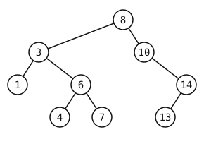
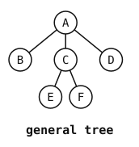
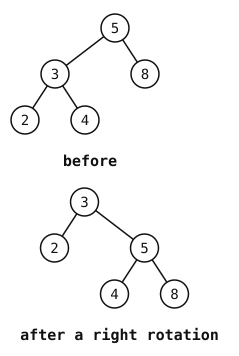
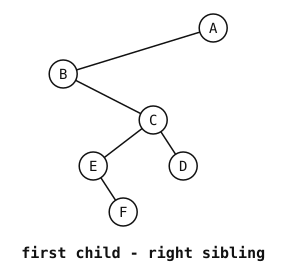

# arbrisseau

Binary and general trees as small SVG files, from nested Python tuples. One file, no dependency.

<p>


</p>

Written for algorithm exercises: binary search trees, heaps, AVL rotations, general trees and their binary form.
The layout gives each node its own column (in-order for binary trees), so labels never overlap, and trees wrap
to a new row past 380 px so a phone shows them near full size. The SVG holds only lines, circles and text: an
`` tag is enough, no script and no data URI.

Made for [EPITA Doomscrolling](https://epitadoomscrolling.pierref.eu), an exam training site for EPITA prépa
students, where it draws the trees of three algorithm courses. By [Morgan Pierrefeu](https://morgan.pierref.eu).

## Install

```bash
pip install git+https://github.com/evaspace/arbrisseau
```

Or copy `arbrisseau.py` into your project. Python 3.8 or newer.

## Trees as tuples

| Tree | Python value |
|---|---|
| binary node | `(key, left, right)` |
| empty subtree | `None` |
| binary leaf | the bare key, `7` |
| general node | `(key, [child, child, ...])` |
| general leaf | the bare key, `"B"` |

```python
from arbrisseau import svg

bst = (8, (3, 1, (6, 4, 7)), (10, None, (14, 13, None)))
open("bst.svg", "w").write(svg(bst))
```

## Several trees, with captions

```python
svg((5, (3, 2, 4), 8), (3, 2, (5, 4, 8)), captions=["before", "after a right rotation"])
```



## General trees and their binary form

```python
from arbrisseau import fcrs, svg

forest = [("A", ["B", ("C", ["E", "F"]), "D"])]
svg(forest[0], general=True, captions=["general tree"])
svg(fcrs(forest), captions=["first child - right sibling"])
```

<p>


</p>

## API

| Name | What it does |
|---|---|
| `svg(*trees, captions=None, general=False, **style)` | SVG text of the trees side by side |
| `save(*trees, folder=".", prefix="tree-", ...)` | writes `folder/<prefix><hash>.svg` and returns the path; the same drawing keeps the same name |
| `fcrs(forest)` | first child - right sibling binary form of a list of general trees |

`style` overrides `STYLE`: `r` (node radius), `dx`, `dy` (spacing), `wrap` (row width in px), `font`, `ink`,
`fill`. Keys are escaped, so `"a<b"` is safe.

## Use on a web page

```markdown

```

Put the tree in words in the `alt` text, for screen readers and "copy for an AI" buttons.

## Tests

```bash
python -m unittest tests/test_arbrisseau.py
python examples/gallery.py   # redraws docs/
```

## License

MIT
